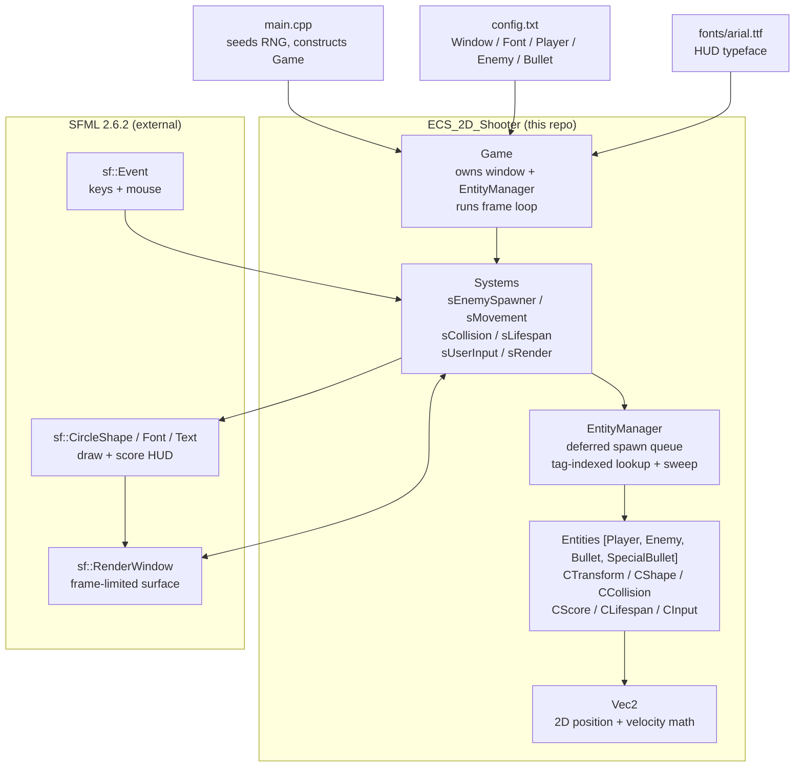

# ECS 2D Shooter

A data-driven 2D arena shooter built in C++ with SFML, organized around a small
Entity–Component–System (ECS) core. You pilot a polygon ship at the center of a
bounded arena, destroy spawning polygon enemies with aimed bullets, and score
points — large enemies split into short-lived fragments when killed.


## Key capabilities

- **Tag-based ECS core** — `EntityManager` (`EntityManager.hpp` / `EntityManager.cpp`)
  stores entities by tag (`Player`, `Enemy`, `Bullet`, `SpecialBullet`) and applies
  deferred spawns plus dead-entity sweeps once per frame in `update()`.
- **Composable components** — entities mix and match `CTransform`, `CShape`,
  `CCollision`, `CScore`, `CLifespan`, and `CInput` (`Component.hpp`). Systems
  operate on component subsets rather than an inheritance hierarchy.
- **Frame-driven game systems** — `Game::run()` (`Game.cpp:449`) ticks
  `sEnemySpawner` → `sMovement` → `sCollision` → `sLifeSpan` every unpaused frame,
  then always runs `sUserInput` and `sRender`.
- **Config-file tuning** — window size, frame limit, font, and all
  player/enemy/bullet parameters load from `config.txt` at startup, so gameplay
  can be rebalanced without recompiling.
- **Enemy splitting** — destroying a full-size enemy spawns one short-lived
  small enemy per polygon vertex via `spawnSmallEnemies()` (`Game.cpp:396`).
  Small enemies are flagged with `Entity::m_smallEnemy` and score double their
  parent's per-kill value.
- **Two shot types** — left click fires a normal `Bullet` that is consumed on
  impact; right click fires a `SpecialBullet` that ricochets off arena walls
  (`sCollision`, `Game.cpp:143`) and is not consumed on impact.
- **Lifespan fading** — `sLifeSpan()` (`Game.cpp:291`) decrements
  `CLifespan::remaining` and fades fill/outline alpha proportionally before
  destroying the entity.
- **Pause and score HUD** — `P` pauses simulation (rendering and minimal input
  continue); the score is drawn each frame with the bundled `fonts/arial.ttf`.

## Architecture



How a frame flows through `Game::run()`:

1. `main.cpp` seeds `rand()` with `time(0)`, constructs `Game("config.txt")`,
   and calls `run()`.
2. `Game::init()` parses `config.txt`, creates the `sf::RenderWindow` with the
   configured frame limit, loads the font, and calls `spawnPlayer()`.
3. Each loop iteration calls `m_entities.update()` first, flushing the
   `m_entitiesToAdd` queue into the master vector and tag map and erasing
   entities flagged by `Entity::destroy()`.
4. When unpaused, the simulation systems run in fixed order: spawner, movement,
   collision, lifespan; `m_currentFrame` increments.
5. `sUserInput()` polls SFML events and `sRender()` repositions, rotates, draws
   every entity, then draws the score text — paused or not.

## Tech stack

| Area | Technology |
|---|---|
| Language | C++17 (`LanguageStandard` = `stdcpp17` in `Assignment2.vcxproj`) |
| Rendering / windowing / input | SFML 2.6.2 (`sfml-graphics`, `sfml-window`, `sfml-system`; `sfml-audio` and `sfml-network` also linked but no audio/network calls exist in source) |
| Build | Visual Studio 2022 (PlatformToolset `v143`), `Assignment2.vcxproj` + `.filters`; Debug/Release × Win32/x64 configurations |
| Math | Hand-rolled `Vec2` (`Vec2.hpp` / `Vec2.cpp`) |
| Config | Plain-text key-value `config.txt`, parsed with `ifstream` in `Game::init()` |
| Font asset | `fonts/arial.ttf` |
| Tests / CI / packaging | None in the repository |

## Project structure

```text
ECS_2D_Shooter/
├── main.cpp              # Entry point: seed RNG, construct Game("config.txt"), run
├── Game.hpp / Game.cpp   # Game class: init, frame loop, 6 systems, 5 spawn helpers
├── Entity.hpp / Entity.cpp
│                         # Entity: id, tag, active flag, small-enemy flag, component slots
├── EntityManager.hpp / EntityManager.cpp
│                         # Deferred spawn queue, tag map, per-frame sweep
├── Component.hpp         # CTransform, CShape, CCollision, CScore, CLifespan, CInput
├── Vec2.hpp / Vec2.cpp   # 2D vector arithmetic used for position and velocity
├── config.txt            # Window, font, player, enemy, bullet tuning
├── fonts/arial.ttf       # HUD font referenced by config.txt
├── Assignment2.vcxproj   # VS2022 project (SFML include/lib paths, C++17)
├── docs/architecture.mmd # Mermaid source for the diagram above
└── x64/                  # Committed VS build artifacts (see Limitations)
```

## Prerequisites and setup

- Windows with **Visual Studio 2022** (v143 toolset, C++ desktop workload) and a
  Windows 10 SDK. Verified with MSVC `14.43.34808` and SDK `10.0.22621.0`.
- **SFML 2.6.2 for Visual C++ 17 64-bit** (the archive whose root contains
  `include\`, `lib\`, and `bin\`). The project does not hardcode its location;
  you point MSBuild at it via the `SFML_DIR` property (see below).
- Build **x64** (Debug or Release). The Win32 configurations in the `.vcxproj`
  carry no SFML include/lib settings and no C++17 language setting, so they are
  not expected to build — this matches the committed project, which only ever
  wired up SFML for x64.

Steps:

1. Clone the repository. There is no `.sln`; open or build
   `Assignment2.vcxproj` directly.
2. Tell the build where SFML lives — any one of:
   - `msbuild Assignment2.vcxproj /m /p:Configuration=Release /p:Platform=x64 /p:SFML_DIR="<your-SFML-2.6.2-root>"`
   - set the `SFML_DIR` environment variable to that root, or
   - copy `Directory.Build.props.sample` to `Directory.Build.props` (git-ignored)
     and set `<SFML_DIR>` in it.
   Building without `SFML_DIR` fails fast with an explicit error instead of
   resolving to a wrong installation.
3. Build (`Ctrl+Shift+B` in Visual Studio, or the `msbuild` command above with
   `Debug` or `Release`). The executable lands at
   `x64\Release\Assignment2.exe` (or `x64\Debug\Assignment2.exe`); both
   directories are git-ignored build output.
4. Stage the runtime DLLs next to the `.exe`: copy `sfml-graphics-2.dll`,
   `sfml-window-2.dll`, and `sfml-system-2.dll` from `<SFML_DIR>\bin`
   (the `-d`-suffixed Debug variants for Debug builds). These are the only
   SFML DLLs the executables import, per `dumpbin /dependents`.
5. Run the `.exe` with the repository root as the working directory (or any
   directory containing `config.txt` and `fonts/arial.ttf`), since `main.cpp`
   loads the relative path `"config.txt"` and the config references
   `fonts/arial.ttf`.

> Verified 2026-10-11 with VS2022 MSBuild 17.13, `SFML_DIR=C:\libraries\SFML-2.6.2`:
> Release|x64 and Debug|x64 both compile and link with 0 errors (17 pre-existing
> C4244/C4267 narrowing warnings in `Game.cpp`/`main.cpp`, untouched), and both
> executables launch and run their render loop. No test suite exists in the repo.

## Configuration

`Game::init()` (`Game.cpp:11`) reads whitespace-separated `config.txt` lines by
leading keyword. Field order matters. The shipped file contains:

```text
Window 1280 720 60 0
Font fonts/arial.ttf 24 255 255 255
Player 32 32 5 5 5 5 255 0 0 4 8
Enemy 32 32 3 3 255 255 255 2 3 8 90 60
Bullet 10 10 20 255 255 255 255 255 255 2 20 90
```

| Line | Fields | Meaning |
|---|---|---|
| `Window` | width, height, frame-limit, fullscreen-flag | `1280×720 @ 60 fps`. The fullscreen flag is parsed but the `create()` call has the fullscreen branch commented out, so windowed mode is always used. |
| `Font` | path, size, R G B | HUD font and color. Missing/unreadable file prints `Could Not load Font!` and exits with `-1`. |
| `Player` | SR CR S FR FG FB OR OG OB OT V | Shape radius, collision radius, speed, fill RGB, outline RGB, outline thickness, polygon vertex count. Shipped: radius 32, speed 5, dark fill `(5,5,5)`, red outline, 8 vertices. |
| `Enemy` | SR CR SMIN SMAX OR OG OB OT VMIN VMAX L SI | Shape/collision radii, speed range, outline RGB/thickness, vertex-count range, lifespan (frames), spawn interval (frames). Shipped: random 3–8 vertices, lifespan 90, spawn every 60 frames. |
| `Bullet` | SR CR S FR FG FB OR OG OB OT V L | Shape/collision radii, speed, fill/outline colors, outline thickness, vertex count, lifespan (frames). Shipped: speed 20, lifespan 90. |

Enemy fill color is randomized per spawn (`Game.cpp:354`); enemy score equals
`vertexCount × 100` (`Game.cpp:370`).

## Usage

Launch the game, then:

| Input | Action |
|---|---|
| `W` / `A` / `S` / `D` | Move up / left / down / right (diagonals normalized via 45° projection) |
| Left mouse click | Fire a normal bullet toward the cursor |
| Right mouse click | Fire a ricocheting special bullet toward the cursor |
| `P` | Pause / resume simulation |
| `Esc` or window close | Quit |

Rules implemented in `sCollision()` (`Game.cpp:98`):

- Touching an enemy resets the player to the arena center and destroys the
  enemy (splitting it first if it is full-size). No lives counter exists — the
  game continues indefinitely.
- Bullets add the victim's `CScore` to `m_score`, split full-size enemies, and
  (normal bullets only) expire on impact.
- Special bullets bounce off walls instead of leaving the arena; normal bullets
  and small-enemy fragments expire via `CLifespan`.

## Testing

No test framework, test files, or CI workflows are present in the repository.
Verification for this documentation was limited to static inspection of all
source files, `config.txt`, and the `.vcxproj`.

## Limitations and future work

- **Build artifacts are committed** — `x64/Debug` and `x64/Release` (`.obj`,
  `.pdb`, `.log`, `.tlog`, `.recipe` files) are checked in. They are generated
  output; a `.gitignore` excluding them has not been added (doing so is left as
  a manual step since modifying repo state beyond docs was out of scope).
- **Windows-only, hardcoded SFML path** — the project expects SFML at
  `C:\libraries\SFML-2.6.2` and only the x64 configurations wire up SFML paths.
  There is no CMake, vcpkg manifest, or portable build script.
- **No tests or CI** — behavior described above comes from code inspection, not
  executed test runs.
- **Latent code issues visible on inspection** (not fixed — docs task only):
  `Vec2::operator!=` (`Vec2.cpp:13`) duplicates the `==` logic; `Vec2::dist`
  and the default `Vec2()` constructor are declared but never defined;
  `spawnBullet`/`spawnSpecialMove` pass `FR` for the blue fill channel instead
  of `FB` (`Game.cpp:378`); the fullscreen config flag is parsed but unused.
- **No license file** — no `LICENSE` or license header was found, so no license
  is stated here.

## Contributing

This is a small single-project repository with no contribution guide, issue
templates, or CI checks. Sensible defaults: keep changes scoped to one system
at a time, match the existing C++ style, tune gameplay via `config.txt` rather
than magic numbers, and do not commit `x64/` build output.
